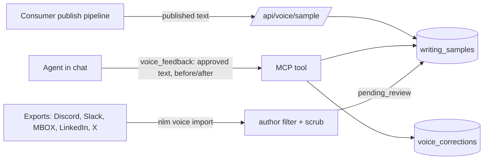

# Voice memory (NxtVoice) in NLM: scope

Status: scope approved with amendments, 2026-11-23, after a critical review
that checked its claims against main 5ca63b3 (see "Review, 2026-11-23" at the
end). Not yet a design; each phase gets its own design. Work-Id: T2438.

## Problem

Agents that write for a person (posts, emails, blogs, scripts, chat) don't
reliably know how that person writes in each place. Today:

- Voice guidance is prose spread across files that some runtimes load and
  others don't. Nothing versions it or tests it.
- When an agent recalls "voice examples" from sessions, it gets drafting
  sessions, which contain the agent's first drafts as well as the person's
  final words. The examples are partly not the person's voice.
- Corrections given in chat ("too formal", "I'd never say leverage") are the
  strongest voice signal a person produces, and they vanish when the session
  ends.

NLM already has the machinery this needs: an outcome-labelled example lane
(`code_exemplars`, `recall_code`), a signal intake (`/api/signal`), session
ingest with a classifier, local embeddings, tenancy, and an MCP surface every
supported runtime loads. Voice memory is a second example lane, for writing.

## Success

A draft is successful when the person approves it **and it is published** to
a live site or channel. The published text, not the last draft in chat, is the
best sample.

Measured per voice and channel:

- **Publish rate:** share of drafts that reach publication.
- **Revisions before approval:** correction rounds between first draft and
  approval.

## Anti-goals

- Never store words the person didn't write as their voice. Other people's
  messages and agent drafts can be context or negatives, never samples.
- Never change a rule without the person's approval.
- Never be required to write. If the voice lane is off or empty, agents get
  rules only (or nothing) and still work.
- No model in the routing lookup. The agent knows it is writing a LinkedIn
  post; resolving voice and channel rules is a deterministic lookup. Models
  only rank examples and label imports.
- Not a publisher or scheduler. NLM learns that something was published; it
  never publishes.

## Concepts

| Term | Meaning |
|---|---|
| **Voice** | Who is speaking: the person, or a brand they run. A tenant can hold several. |
| **Channel** | Where it is written: `linkedin`, `x`, `email-professional`, `email-informal`, `discord`, `slack`, `blog-personal`, `blog-professional`, `video-script`, `youtube-comment`, and so on. The vocabulary comes from the rules files, not code. |
| **Audience** | Who is reading. Writing for a client's readers is the person's voice adjusted for that audience, not a separate voice. Audiences adjust rules; they never replace the voice. |
| **Rules** | Per-voice rules plus per-channel and per-audience overrides, in YAML validated against a JSON schema. The person owns them in their own git repository. |
| **Sample** | A piece of the person's own writing, with provenance and an outcome. |

## Boundary

**In NLM (this repo):**

- Writing-sample storage, embeddings and labels.
- Intake: publish signals, chat feedback, session sweep, bulk importers.
- `recall_voice`: resolved rules plus ranked examples, in one call.
- Rule-change proposals from repeated corrections (as patches, never applied).
- Metrics and eval-case export.
- Reading the rules directory (read-only).

**Outside NLM:**

- **Rules files:** user data in a git repository the person owns. NLM records
  the commit it read so every recall and eval names a rules version.
- **Pre-send checks:** the consumer's deterministic gate (banned phrases,
  unsourced numbers) reads the same rules files.
- **Publish producers:** the consumer's publishing pipeline emits a signal when
  something goes live. NLM never connects to a CMS, CRM or social API.
- **UI:** a desktop panel calls NLM's HTTP API for import review, sample
  curation and rule-proposal approval.

## Data model (sketch)

Gated behind `NLM_VOICE_ENABLED=1`, default off, like `code_exemplars`. SQLite
migration plus the Postgres mirror under `migrations/pg`.

`writing_samples`

| Column | Notes |
|---|---|
| `id` | hash of scope, voice, text hash, source |
| `install_scope` / tenant | existing tenancy rules |
| `voice`, `channel`, `audience` | `audience` nullable |
| `source` | `published`, `approved`, `import`, `onboarding` |
| `source_ref` | URL or upstream record ID; provenance only |
| `text`, `text_hash` | the person's words only; hash for dedup |
| `context` | what it replied to or the request; never embedded as voice |
| `outcome` | `published`, `approved`, `rejected`, `pending_review` |
| `register`, `form` | classifier labels (casual/professional; reply, announcement, how-to) |
| `draft_id` | links a published sample back to the recall that produced the draft |
| `session_id`, `rules_version`, `ts` | provenance |

`writing_samples_vec`: vec0 lane, same text embedder as sessions (lanes are
separate tables, as with code).

`voice_corrections`: `voice`, `channel`, `request`, `before_text`,
`after_text`, `instruction`, `session_id`, `ts`. These are the before/after
pairs that become eval cases and rule proposals.

Ranking weight: published > approved > reviewed import > onboarding.
`rejected` and correction `before_text` surface only as negatives.
`pending_review` never surfaces.

## Intake

1. **Publish intake (primary).** A dedicated endpoint, `POST /api/voice/sample`,
   with outcomes `published | approved | rejected`, plus a best-effort producer,
   `nlm voice-signal --voice --channel --text-file --url [--draft-id]`, that
   mirrors `nlm code-signal`: loopback POST, a down daemon warns and exits 0.
   Not a new `SignalKind`: signals are telemetry (required `model`, `repo` and
   `step`; outcomes `pass | fail | fix | exhausted`; pruned after
   `NLM_SIGNAL_RETENTION_DAYS`, default 90), and the outcome rollups read every
   signal of a session (`sqlite-outcome-store.ts`), so voice rows would skew
   them and put the person's text into telemetry.
2. **Published backfill (phase 1).** `nlm voice backfill` reads content that is
   already published, through a reader per source: blog Markdown files, and the
   content pipeline's records (NocoDB Content rows marked Published and their
   Social Media rows, which hold the posted body). It lands them as
   `source = published` with the URL or record ID as `source_ref`. Without it,
   phase 1 starts with no samples and cannot beat session recall.
3. **Chat feedback.** A `voice_feedback` MCP tool: the agent records the
   approved final text and each before/after correction while the person is
   talking.
4. **Bulk import.** `nlm voice import <format> <path> --author-id <id>...`
   with one reader per format. Steps: keep only the person's messages (others
   become `context`), drop low-value messages (acks, bare links), scrub secrets
   and personal data, label with the classifier, embed, and land as
   `pending_review` until approved through the API.

## Recall

`recall_voice({ voice, channel, audience?, request, k = 3 })` returns:

- `rules`: resolved rules (voice, then channel, then audience overrides) and
  `rules_version`.
- `examples`: the top k samples by similarity to `request`, published first.
- `avoid`: near-match rejected drafts and correction pairs.
- `draft_id`: for the consumer to pass along to the publish signal.

It fits the existing response budget. With no samples it returns rules only.
With no rules for that voice it returns an empty result, never an error.

## Learning loop

- When the same correction recurs on a voice and channel (threshold set in
  design), NLM drafts a rule change as a patch against the rules repository
  and surfaces it for approval. It never writes the rules.
- Correction pairs export as eval cases ("given this request, not this; like
  that") so a rules change can be scored against real past corrections before
  it ships.

## Metrics

`nlm voice stats [--voice] [--channel] [--since]`: drafts recalled, approved,
published, publish rate, and revisions before approval. Revisions come from
`voice_corrections` keyed by `draft_id`.

## Privacy

Samples are tenant-scoped, never in telemetry, digests or any export except an
explicit per-tenant one. Importers scrub before storage. `docs/data-boundary.md`
gains a voice section.

## Phases

Each phase is test-first, behind the flag, and independently useful.

1. **Store, publish intake, backfill, recall.** Migration, `/api/voice/sample`
   and `nlm voice-signal`, `nlm voice backfill` for already-published content,
   the rules reader with the NLM-shipped schema, and `recall_voice` with rules
   plus published examples. First consumers: the email-composer and
   content-director agents, which recall voice from sessions today.
2. **Feedback and metrics.** `voice_feedback`, `voice_corrections`, `draft_id`
   linking, `nlm voice stats`.
3. **Importers.** Readers per format, author filter, scrub, review API.
4. **Learning.** Rule-change proposals and eval-case export.
5. **UI.** The desktop panel (outside this repo) over the HTTP API.

## Deferred

- **Session sweep.** Marking corrections during session ingest means changing
  the core classifier's output schema (local model, schema-validated), which
  every session ingest depends on. `voice_feedback` and the publish intake
  cover the signal; revisit only if measured gaps show missed corrections.

## Open questions

1. **Rules location:** NLM ships and validates the JSON schema (it reads the
   files, so it owns the contract); `NLM_VOICE_RULES_DIR` has no default, and
   unset means rules-only recall returns no rules. Still open: which repository
   holds Edward's rules. Today his voice guidance is prose
   (`.claude/context/edward-voice-guide.md` and `.claude/rules/nocodb-voice.md`
   in Whtnxt Agent) plus checks in nxtsocial and nxtjobs; phase 1 converts the
   guide to the YAML format, and the existing checks read it later.
2. **Draft-to-publish link:** can every publisher carry `draft_id`? Without it,
   publish rate still works, but revisions before approval only covers drafts
   that went through `voice_feedback`.
3. **Embedder:** the session text embedder, or a dedicated one for short-form
   writing? Decide on an eval, not taste.
4. **Team mode:** in hosted or team installs, does a brand voice belong to the
   team tenant, and who may approve rule changes?
5. ~~**Signal shape**~~: resolved, a separate endpoint (see Intake 1).

## Review, 2026-11-23

Claims checked against main 5ca63b3 before approval.

| Claim | Result |
|---|---|
| An outcome-labelled example lane exists (`code_exemplars`, `recall_code`) | True: migrations 021/023/024, `recall_code` in `src/mcp/server.ts` |
| Feature flag pattern like code exemplars | True: `NLM_CODE_EXEMPLARS_ENABLED` gates capture and backfill |
| Postgres mirror under `migrations/pg` | True |
| Tenancy via `install_scope` | True: signals and code exemplars carry it |
| `nlm code-signal` is the producer pattern | True: `src/cli/nlm.ts` (`code-signal`), loopback POST to `/api/signal`, exemplar capture in `src/http/app.ts` |
| Recall fits a response budget | True: `maxChars` (2,000-20,000, default 8,000) on recall tools |
| `docs/data-boundary.md` exists | True |
| Voice samples can ride `/api/signal` as a new kind | **False in practice.** Required telemetry fields, a code outcome vocabulary, 90-day pruning, and outcome rollups that read every signal of a session. Amended to a dedicated endpoint |
| Phase 1 alone gives agents examples | **Not without a backfill:** samples only arrive as new content publishes. Amended: published backfill in phase 1 |
| Session ingest can mark corrections | Needs a core classifier schema change. Deferred |
